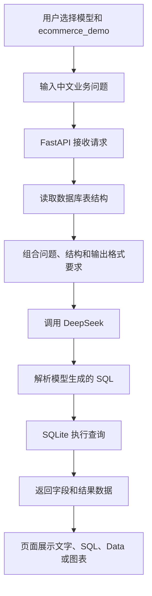
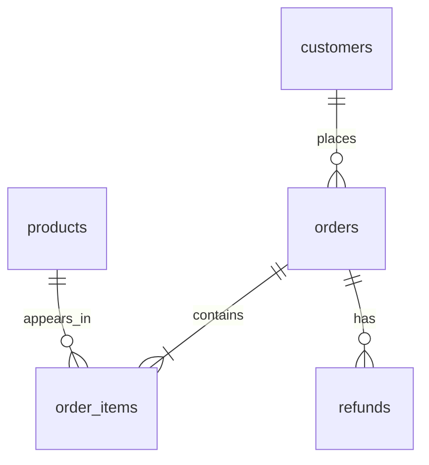

# 电商智能问数系统：项目功能详解

> 文档更新：2026 年 10 月 26 日  
> 项目目录：`E:\vscode_qy\ecommerce-ai-analytics`  
> 基础项目：DB-GPT v0.8.2  
> 当前模型：DeepSeek `deepseek-flash`；百炼 `text-embedding-v4`（1024 维）、`qwen3-rerank`  
> 本地地址：<http://127.0.0.1:5670>

本文介绍当前项目的用户功能、业务数据、执行流程、配置方式、接口和源码位置。内容依据本地源码、配置文件及已有验证记录编写，覆盖用户可见的主要功能和本地部署配套功能，不逐一解释框架内部的每个 Python 函数。

**当前项目是“DB-GPT 原版应用 + 电商数据 + DeepSeek 接入 + 本地运行脚本”的开发基础。电商专属首页、企业级权限体系和完整模型评测尚未完成。**

## 目录

1. [项目定位和当前状态](#1-项目定位和当前状态)
2. [技术组成与工作流程](#2-技术组成与工作流程)
3. [首页和功能导航](#3-首页和功能导航)
4. [六个内置应用](#4-六个内置应用)
5. [电商智能问数详解](#5-电商智能问数详解)
6. [对话和结果处理](#6-对话和结果处理)
7. [数据库管理](#7-数据库管理)
8. [应用程序管理](#8-应用程序管理)
9. [AWEL 工作流](#9-awel-工作流)
10. [模型管理](#10-模型管理)
11. [知识库与 RAG](#11-知识库与-rag)
12. [Agent、技能和文件分析](#12-agent技能和文件分析)
13. [外部连接器](#13-外部连接器)
14. [定时任务](#14-定时任务)
15. [提示词、反馈与评测](#15-提示词反馈与评测)
16. [本地部署配套功能](#16-本地部署配套功能)
17. [接口调用说明](#17-接口调用说明)
18. [数据字典和业务口径](#18-数据字典和业务口径)
19. [功能边界和后续开发](#19-功能边界和后续开发)
20. [源码阅读地图](#20-源码阅读地图)
21. [常见问题](#21-常见问题)
22. [附录：12 条参考 SQL 与结果](#附录12-条参考-sql-与结果)

## 1. 项目定位和当前状态

### 1.1 这个项目解决什么问题

普通业务系统往往要求用户先找到报表，再设置筛选条件；临时统计则需要开发人员编写 SQL。本项目提供另一种入口：用户使用中文提问，模型结合数据库结构生成 SQL，后端执行查询，再以文字、SQL 和表格等形式展示结果。

以电商场景为例，可以查询订单数量、销售额、商品销量、渠道贡献、省份分布、退款和复购情况。系统同时保留 DB-GPT 的通用应用能力，例如普通聊天、文档问答、文件分析、工作流和 Agent 工具调用。

### 1.2 本文采用的状态标记

| 状态 | 含义 |
|---|---|
| **已验证** | 当前本地环境有真实执行或页面检查记录，且结果符合预期 |
| **已配置** | 本地配置或服务已经准备好，但不代表每个子功能都完成了业务验收 |
| **原版具备，待验收** | 本地源码存在相应实现或页面，当前未逐项运行验证 |
| **需要额外配置** | 需要新增模型、数据库、文件、连接器或其他依赖才能完成对应流程 |
| **后续开发** | 本地版本尚未实现的业务定制，不能当作现成功能介绍 |

“页面上有一个入口”和“该功能已经在当前环境完整验证”是两个不同结论。后文会分别说明。

### 1.3 当前已经完成的内容

| 项目 | 当前状态 |
|---|---|
| DB-GPT Web 页面和后端服务 | 已验证 |
| 独立 Python 环境与锁定依赖 | 已配置，服务启动成功 |
| DeepSeek 官方 API 接入 | 已验证，模型为 `deepseek-flash` |
| 电商模拟数据库 | 已验证，包含五张业务表和两个分析视图 |
| 数据源连接、表结构读取 | 已验证 |
| 中文问题 → 模型生成 SQL → 执行 → 返回结果 | 已验证一条完整链路 |
| 12 条参考 SQL 经 DB-GPT HTTP 接口执行 | 已验证，结果全部匹配基准 |
| Windows 启动、停止和重复启动检查 | 已验证 |
| embedding 模型、Schema 向量索引 | 百炼 `text-embedding-v4` 已验证，Schema 索引已建立 |
| reranker 模型 | 百炼 `qwen3-rerank` 已验证，知识问答场景按默认排序模型配置接入 |
| 企业数据库、外部连接器和定时业务任务 | 未配置业务实例 |
| 电商专用界面、角色隔离、完整模型准确率评测 | 后续开发 |

### 1.4 已验证的真实例子

问题：

> 请查询电商数据库中 orders 表共有多少笔订单。只进行只读查询。

模型生成：

```sql
SELECT COUNT(*) AS order_count FROM orders;
```

数据库返回：

| order_count |
|---:|
| 1500 |

该结果来自真实模型调用和实际数据库执行。记录保存在 `work/model-smoke-test.json`。它证明链路可用，**不等于 Text-to-SQL 正确率达到 100%**。

## 2. 技术组成与工作流程

### 2.1 使用什么语言和技术

| 层次 | 当前使用的技术 | 负责的内容 |
|---|---|---|
| 页面 | TypeScript、React、Next.js、Ant Design | 页面、表单、对话、表格、图表、管理功能 |
| 服务端 | Python、FastAPI、Uvicorn | 接口、对话调度、模型调用、数据库访问 |
| 数据访问 | SQLAlchemy、SQLite 连接器 | 连接元数据和业务数据库，执行 SQL |
| 大模型 | DeepSeek 在线 API | 理解中文需求、生成 SQL 和分析内容 |
| 本地业务数据 | SQLite | 电商客户、商品、订单、明细、退款 |
| 系统元数据 | 独立 SQLite | 对话、应用、数据源、模型等系统记录 |
| 向量存储 | Chroma + 百炼 embedding | 已用于 Schema 索引；文档导入和问答仍待验收 |
| 环境管理 | uv、Python 3.11、上游 uv.lock | 创建环境，按锁文件安装依赖 |
| 启停 | PowerShell、CMD | 后台启动、停止、状态检查 |

本次使用的是在线模型，电脑不负责运行 DeepSeek 模型权重，也不需要为当前问数链路安装 GPU 推理服务。

### 2.2 一次问数请求如何执行



当前电商库规模较小，未配置向量模型时，Chat Data 的源码有读取普通表结构的回退路径，因此可以直接完成 SQL 生成。它不依赖“先把所有表向量化”这一步。

### 2.3 哪些数据保存在本地，哪些请求访问外部

- 电商模拟数据库、系统元数据、运行日志和本地配置保存在项目目录。
- 生成答案时，所需的问题、表结构和对话上下文会发送给 DeepSeek。不同分析模式也可能把工具读取到的结果用于后续模型分析。
- 当前电商数据是虚构样例数据；“数据库文件在本地”不表示整个 AI 推理过程离线。
- 当前服务只监听 `127.0.0.1:5670`，本次没有配置公网发布。

## 3. 首页和功能导航

### 3.1 首页：通用数据助手入口

首页提供自然语言输入框和数据库、文件、技能、连接器等选择入口。用户可以从一个任务开始，而不必先创建复杂工作流。

原版首页还展示示例任务，例如沃尔玛销售数据分析、数据库画像、财报分析和 SQL 分析技能创建。这些示例说明原项目的通用用途，**并不表示已经针对电商业务完成了专属定制或全部示例验收**。

### 3.2 管理导航的八个主要模块

| 模块 | 地址 | 用途 |
|---|---|---|
| 应用程序 | `/construct/app` | 选择内置应用、管理自定义应用 |
| AWEL 工作流 | `/construct/flow` | 编排、调试和管理流程 |
| 模型管理 | `/construct/models` | 查看、创建、启动、停止模型服务配置 |
| 数据库 | `/construct/database` | 连接和管理数据源 |
| 知识库 | `/construct/knowledge` | 管理文档、分块和检索配置 |
| 技能 | `/construct/skills` | 查看、上传和导入技能包 |
| 连接器管理 | `/construct/connectors` | 管理外部系统工具连接 |
| 定时任务 | `/construct/scheduled-tasks` | 管理按时间重复执行的任务 |

窗口较窄时，部分导航或控件可能被收起或挤出可视区域。学习和演示时建议扩大浏览器区域。

## 4. 六个内置应用

内置应用是不同任务模式的入口，不是六套独立部署的服务。

### 4.1 Chat Data：数据库智能问数

**用途：** 将业务问题转换为 SQL，并执行查询。

**输入：** 模型、数据库、中文问题、可选对话上下文。

**处理：** 读取结构 → 构造数据库问答提示词 → 调用模型 → 解析 SQL → 执行 → 组织展示数据。

**输出：** 简要说明、SQL、查询结果，以及格式兼容时的图表。

**使用步骤：**

1. 打开“应用程序”。
2. 在 **Chat Data** 卡片中选择“开始对话”。
3. 选择模型 `deepseek-flash`。
4. 选择数据源 `ecommerce_demo`。
5. 输入一个明确的问题，例如“统计 paid 和 completed 状态订单的销售总额，单位为元”。
6. 在回答下方分别查看 **SQL** 和 **Data**。

**当前状态：已验证。** 它是本次电商项目最核心、也最适合先继续开发的入口。

### 4.2 Chat DB：数据库结构问答

**用途：** 帮助理解数据库，而不只关注某个指标数值。

适合的问题包括：

- `orders` 和 `order_items` 分别存放什么？
- 商品和订单之间如何关联？
- 查询各省销售额需要关联哪些表？

它属于数据库元数据问答模式，与 Chat Data 的“生成并执行查询”侧重点不同。不能仅凭该入口存在，就认定每次回答都会执行 SQL。

**当前状态：原版具备，待单独验收。**

### 4.3 Chat Normal：通用模型聊天

**用途：** 普通问答、文字解释、内容整理和生成。

例如可以询问客单价的定义，或让模型解释某条 SQL。未明确连接数据库并执行工具时，模型给出的数字不能视为当前电商库的查询结果。

**当前状态：入口已部署；本次真实模型验证使用的是 Chat Data，未另外验收普通聊天的全部交互。**

### 4.4 Chat Excel：文件数据分析

**用途：** 围绕上传的表格文件理解字段、分析数据并回答问题。

与 Chat Data 的区别在于数据入口：前者面向上传文件，后者面向已登记的数据库。比如临时收到一份渠道销售表，可以先走文件分析，不必先设计持久化业务表。

**典型流程：** 上传支持的文件 → 识别数据结构 → 选择模型 → 提问 → 查看分析结果。具体可接受格式、大小和解析能力，应以所用上传入口的能力说明为准。

**当前状态：原版具备，待文件样例验收。** 没有把本次 1,500 笔电商订单另行导出并验证该模式。

### 4.5 Chat Dashboard：分析报表

**用途：** 围绕数据分析需求生成报表或可视化内容，适合多指标的综合展示。

例如“分析各渠道销售表现，并展示销售额和订单数”。实际结果仍取决于数据结构、模型生成质量和前端图表协议，不保证所有问题都能直接生成完整看板。

**当前状态：原版具备，待电商报表验收。** 固定布局的电商经营驾驶舱属于后续业务开发。

### 4.6 Chat Knowledge：知识库问答

**用途：** 根据导入的文档检索相关内容，再让模型结合这些内容回答。

电商场景可以导入售后规则、退款政策、商品说明或内部操作手册。它回答的是文档知识，与查询 `orders` 中的订单数量属于不同数据链路。

**当前状态：模型已配置，文档流程待验收。** 已接入百炼 embedding 和 reranker，并验证真实 API 及应用内部调用；尚未验收企业文档导入、索引和完整知识问答流程。

## 5. 电商智能问数详解

### 5.1 业务数据覆盖范围

当前业务数据库包含五类数据：客户、商品、订单、订单明细和退款。使用固定随机种子生成，便于重复构建开发和测试环境。

| 数据 | 初始数量 | 说明 |
|---|---:|---|
| 客户 | 300 | 使用“示例客户”名称和省份 |
| 商品 | 20 | 数码、家居、服饰、食品四类 |
| 订单 | 1500 | 覆盖多日期、多渠道、多状态 |
| 订单明细 | 3751 | 记录商品、数量和成交单价 |
| 退款 | 107 | 包含金额、日期和原因 |

数据覆盖 2026-07-01 至 2026-10-25。初始化脚本检测到已有数据库时会保留数据；修改数据库后，统计结果可能与本文初始快照不同。

### 5.2 订单数量统计

**解决的问题：** 全部订单有多少、已完成订单有多少、各状态分别多少。

**涉及数据：** `orders`。

**关键区别：** “全部订单数”包含待支付和取消订单；“支付订单数”在本样例中只统计 `paid`、`completed`。

模型需要根据问题决定是否加入状态过滤。最简单的总订单数查询已经通过真实模型验证。

### 5.3 销售额统计

**解决的问题：** 支付销售额、某段时间销售额、不同维度销售额。

金额字段 `order_amount_cents` 的单位为分。展示“元”时应除以 `100.0`，并明确订单状态。

```sql
SELECT ROUND(SUM(order_amount_cents) / 100.0, 2) AS gross_sales_yuan
FROM orders
WHERE status IN ('paid', 'completed');
```

初始参考结果为 **1,774,128.00 元**。这是基准 SQL 的执行结果，不意味着模型对所有同义问法都已验证。

### 5.4 按日销售趋势

**解决的问题：** 哪天销售额高、每天有多少支付订单。

可以直接读取 `v_daily_sales` 视图，也可以由模型对 `orders` 按日期聚合。视图提供 `sales_date`、`paid_order_count`、`gross_sales_yuan` 三个字段。

**输出：** 按日期排序的数据表；图表格式适配时可以展示趋势。

本样例使用固定时间段。提问“最近七天”时，需要说明按当前日期还是按数据最后日期计算，避免未来演示时落入无数据区间。

### 5.5 商品销量和销售额排行

**解决的问题：** 热销商品、商品收入贡献、商品销量排名。

涉及 `order_items`、`orders` 和 `products`，也可以读取 `v_product_sales`。

这里必须区分：

- **销量：** 商品数量合计。
- **订单数：** 含该商品的订单数量。
- **销售额：** 明细金额合计。

这三个指标不能混用。参考题中的销售额 Top 5 已通过 SQL 执行验证。

### 5.6 渠道分析

**解决的问题：** APP、小程序、网页、直播渠道的订单量和销售额对比。

**涉及字段：** `orders.channel`。

**输出：** 每个渠道的支付订单数和销售额。可以扩展为渠道占比或指定日期区间对比，但转化率、投放 ROI 等还需要曝光、点击、广告费用数据，当前数据库没有这些字段。

### 5.7 客单价分析

本样例客单价定义为：

> paid / completed 订单的销售额 ÷ paid / completed 订单数。

不是“销售额 ÷ 客户总数”，也不是按商品件数求平均。初始参考结果为 **1,382.80 元**，按两位小数展示。

### 5.8 地区分析

**解决的问题：** 各省份客户贡献了多少销售额。

需要将 `orders.customer_id` 与 `customers.customer_id` 关联，再按 `province` 分组。

**口径：** 当前用的是客户记录中的省份，不是订单收货地址；项目没有单独的订单地址表。

### 5.9 商品类目分析

**解决的问题：** 四个商品类目的销量和销售额分别是多少。

基于 `products.category` 分组，并过滤订单状态。本样例可以从商品分析视图继续聚合。

**业务意义：** 用于观察不同类目的贡献。毛利率、库存周转率等需要成本和库存数据，当前没有实现。

### 5.10 退款与净销售额

**退款总额：** `refunds.refund_amount_cents` 合计后换算为元。

**净销售额：** 当前整个数据集的有效订单销售额减退款总额。

初始参考快照：

| 指标 | 结果 |
|---|---:|
| 退款总额 | 72,343.59 元 |
| 净销售额 | 1,701,784.41 元 |

如果后续查询“九月净销售额”，还需要明确退款按订单发生时间还是退款发生时间归属。本项目尚未把这种区间归属做成统一的指标层。

### 5.11 高价值客户分析

**解决的问题：** 哪些客户累计消费最多。

关联订单和客户，按客户聚合有效订单金额，再排序。当前参考题提供消费金额 Top 10。

这是累计消费金额排名，不等于已经实现了客户终身价值预测、流失预测或用户画像模型。

### 5.12 复购客户统计

本样例将“至少有两笔 paid / completed 订单的客户”视为复购客户，初始参考结果为 **274 人**。

复购客户数不等于复购率。计算复购率还需要明确分母是所有客户、支付客户还是某个统计期内的新增客户。

### 5.13 自然语言问题怎样写更准确

建议问题包含四项：**时间范围、订单状态、指标、分组维度**。

例如：

> 统计 2026 年 9 月 paid 和 completed 订单，按渠道汇总订单数和销售额，金额单位为元，按销售额降序。

相比“分析销售情况”，这样的输入更容易生成可检查的 SQL。重要结果应同时查看 SQL 和 Data，而不是只看模型解释文字。

## 6. 对话和结果处理

### 6.1 新建对话与历史记录

系统使用对话 ID 管理会话，支持创建对话、展示最近记录和读取历史消息。不同应用可以使用不同的对话模式。

切换历史会话后，应再次确认模型和数据库选择。本次验证中，前端曾显示默认 `Walmart_Sales`；它是原版自带样例，不是 `ecommerce_demo`。不能把默认选择直接当成电商库。

### 6.2 多轮追问

对话模块支持保存历史，并在相关模式中用于后续上下文。用户可以在一次销售统计之后继续追问“再按渠道拆分”。

**当前状态：原版具备；本次只验证了单轮订单数量查询，未完成多轮准确率评测。** 多轮时仍需要检查后续 SQL 是否延续了时间和状态条件。

### 6.3 流式回复

后端通过 SSE 等接口逐步推送输出，页面可以随生成过程更新文字或工具状态。流式输出改善等待体验，但不代表 SQL 已经执行完毕；应以最终结果数据为准。

### 6.4 SQL、Data 和 Chart 三种视图

| 标签 | 内容 | 适合做什么 |
|---|---|---|
| SQL | 查询语句 | 检查表名、关联、过滤条件、金额单位 |
| Data | 实际结果表格 | 核对数值、字段和行数 |
| Chart | 对应图表 | 观察趋势和分布 |

**当前实际表现：** 已验证查询在 Data 中显示 `order_count = 1500`。同一回答的 Chart 曾提示“暂无合适的可视化视图”，因此当前不能宣称所有回答均自动生成正确图表。图表类型和渲染协议仍有适配空间。

### 6.5 手动 SQL 编辑和执行

源码包含 SQL 编辑器、数据库表结构树、执行接口和执行结果展示。它允许在模型结果基础上进一步检查或调整查询。

**已验证的部分：** SQL 执行 HTTP 接口能够连接电商库，并正确执行 12 条参考 SQL。

**边界：** 原版 SQL 编辑器接口并非完整只读沙箱；源码的简单 SQL 过滤也不能等价为生产级权限控制。本文中的示例全部使用 SELECT。

### 6.6 参数调整

- **模型选择：** 决定调用哪个已启动模型；当前使用 `deepseek-flash`。
- **数据库选择：** 决定本轮查询哪个数据源；电商场景选 `ecommerce_demo`。
- **temperature：** 控制输出采样随机性，不是 SQL 准确率的开关。
- **max_new_tokens：** 控制生成长度，与模型上下文窗口不是同一参数。

过短的输出限制可能截断 SQL 或 JSON；过长也不自动提高质量。当前在线配置的上下文上限为 65,536，前端输出长度按应用或输入面板设置。

### 6.7 停止、清理、复制和删除

页面和接口包含停止生成、清理输入或对话、复制消息、删除历史等操作。具体清理对象要看当前按钮：清空输入不等于删除数据库，删除会话也不等于删除电商业务数据。

这些是原版交互能力，本次没有为每个操作执行破坏性验收。

### 6.8 导出和分享

源码包含消息导出以及基于 token 的会话分享、读取和撤销接口。分享内容的范围和显示效果需要进一步验收。

本地地址只在当前电脑可访问；创建一个 localhost 分享路径，并不自动让其他电脑能访问服务。本次没有创建公开分享或进行公网部署。

## 7. 数据库管理

### 7.1 查看数据源类型与已连接实例

数据库页面按类型展示连接入口，例如 SQLite、MySQL、PostgreSQL、DuckDB、ClickHouse、Oracle 等。类型卡片表示原项目具备相应连接器抽象或支持入口，不表示已经安装所有驱动、拥有这些数据库或验证了全部连接。

当前实际连接的是 SQLite，包含：

- `ecommerce_demo`：本次创建的电商模拟数据库。
- `Walmart_Sales`：上游自带销售示例数据库。

### 7.2 新增数据源

通常步骤为：选择类型 → 填写连接参数 → 测试连接 → 保存。

SQLite 主要填写文件路径；网络数据库通常需要主机、端口、数据库名、用户名等参数。是否还需驱动、SSL 或其他选项取决于连接器。

本项目采用注册脚本直接登记电商库，避免未配置 embedding 时触发不必要的 Schema 向量化。

### 7.3 连接测试

连接测试检查当前参数能否建立数据库连接，不调用大模型，也不证明用户问题能够正确转换为 SQL。

**当前状态：电商库连接测试已通过。**

### 7.4 表结构读取

系统可读取表名和字段，供结构树展示及 SQL 生成使用。它是智能问数的重要基础：模型应该使用实际表结构，而不是凭空猜测字段。

**当前状态：已验证客户、商品、订单、明细和退款五张表的读取。**

### 7.5 修改、刷新和删除

原版提供修改连接、刷新数据库描述、删除连接配置等能力。删除一个数据源配置与直接删除 `.db` 文件是不同操作。

Schema 刷新涉及索引时，需要相应 embedding 能力；当前已接入百炼向量模型，启动日志已确认 Schema 索引初始化成功，手动刷新流程仍待单独验收。

### 7.6 元数据与业务数据分离

| 文件 | 用途 |
|---|---|
| `data/metadata/dbgpt.db` | 系统应用、对话、数据源等元数据 |
| `data/ecommerce.db` | 电商业务表和分析视图 |

这种分离便于修改业务样例，同时保留系统会话和配置。停止服务不会删除任一数据库。

## 8. 应用程序管理

### 8.1 应用列表、搜索和状态筛选

应用页显示名称、描述、类型、发布时间或更新时间等信息，支持按名称搜索和按“全部／已发布／未发布”筛选，并提供分页。

当前已看到六个内置应用卡片。发布状态是应用管理状态，不代表服务已经公开到互联网。

### 8.2 创建和编辑应用

创建应用将名称、描述、语言、运行模式、模型和所需资源等组织成一个可重复使用的入口。源码中包括单 Agent、自动规划和 AWEL 工作流应用等模式，具体表单随模式变化。

电商场景可进一步创建“电商经营分析助手”，预设模型、业务说明和数据资源，减少每次手动选择。

**当前状态：原版具备，尚未创建并验收电商专用自定义应用。**

### 8.3 发布、取消发布和删除

应用可以发布供相应入口使用，也可以取消发布；删除用于清理应用定义。是否影响关联记录，应以实际实现和操作提示为准。

本次没有对现有内置应用执行删除或发布状态修改。

### 8.4 复制与配置复用

页面具有复制入口，可用于复用应用配置或标识；具体复制对象取决于对应按钮实现。不能把所有“复制”按钮一概理解为完整克隆一个可独立运行的应用。

### 8.5 应用管理员配置

源码有获取和更新应用管理员列表的入口，可用于原版应用管理流程。当前未验收真实多用户登录、部门隔离、行级权限或跨租户访问控制，不能将其等同于已实现的企业权限系统。

## 9. AWEL 工作流

AWEL 用于把模型、数据和处理步骤组织成显式流程。与让 Agent 自主决定每一步不同，工作流更强调预先定义的节点和依赖。

### 9.1 流程列表与创建

可管理流程名称、描述等信息，并进入画布编辑。源码也提供模板、分页和相关状态管理能力。

### 9.2 节点与连线

画布使用节点表示处理步骤，连线表达数据流或依赖。节点的可选参数和类型由服务端注册信息提供。

电商场景可以设计：问题输入 → 指标口径补全 → SQL 生成 → SQL 检查 → 查询 → 展示。

**这只是可建设的业务流程，当前还没有在画布中完成这套电商工作流。**

### 9.3 参数与变量

工作流可配置节点参数，并管理复用变量。这样可以把模型、提示词和数据资源从流程逻辑中分离。

变量管理入口存在，不代表所有配置都自动加密或已经完成权限验证。真实凭据仍应按相应配置机制处理。

### 9.4 调试和执行

后端提供工作流调试接口，便于检查节点配置、输入输出和运行异常。流程执行需要对应的模型、连接器或数据源可用。

### 9.5 导入、导出与复制

源码包含工作流导出、导入、模板读取和复制相关实现，适合迁移或复用流程定义。导出的流程定义不等于同时导出了数据库、模型密钥和所有外部依赖。

**当前状态：工作流模块已部署，尚未对自定义电商流程进行端到端验收。**

## 10. 模型管理

### 10.1 查看模型状态

模型页用于展示模型名称、类型、管理地址、服务地址、心跳和运行状态等信息。后端还提供可用模型名称列表，供聊天输入面板选择。

当前模型列表已验证返回 `deepseek-flash`。

### 10.2 新增、启动和停止

原版支持配置模型服务，并通过管理接口启动、停止或停止后删除。模型可以是本地部署模型，也可以是远程 API 代理；两者的资源要求不同。

当前采用 **远程 API 代理**：本地负责请求转发和对话调度，实际模型由 DeepSeek 提供。

### 10.3 DeepSeek 当前配置

| 配置 | 当前值 |
|---|---|
| 模型名 | `deepseek-flash` |
| 适配器 | `proxy/deepseek` |
| API 地址 | `https://api.deepseek.com` |
| thinking 模式 | 关闭 |
| 本地配置上下文长度 | 65536 |
| 并发配置 | 4 |
| 密钥来源 | 本地 `.env` 环境变量 |

并发数 4 是配置值，不是已经测得的吞吐量。关闭 thinking 模式用于减少结构化输出解析上的不确定性，并不保证所有 SQL 都正确。

### 10.4 聊天模型、embedding 和 reranker 的区别

| 类型 | 作用 | 本地状态 |
|---|---|---|
| LLM／聊天模型 | 理解问题、生成 SQL 和文字 | 已配置并验证 |
| embedding 模型 | 将文本或 Schema 转成向量，用于相似性检索 | 百炼 `text-embedding-v4`，1024 维，真实调用已验证 |
| reranker 模型 | 对检索候选内容再次排序 | 百炼 `qwen3-rerank`，真实调用已验证 |

提供聊天 API，不代表同一密钥或同一模型就能完成向量化。本次未额外下载本地模型权重。

## 11. 知识库与 RAG

RAG 的基本流程是：导入资料 → 解析和分块 → 建立索引 → 按问题检索 → 模型结合召回内容回答。

### 11.1 知识空间

知识空间用于组织一组相关文档，例如“售后政策”或“商品培训资料”。源码提供创建、查询、删除及参数配置能力。

### 11.2 文档添加、上传和管理

可管理知识库文档的名称、类型、内容或文件来源，并进行列表查看、编辑和删除。具体支持格式取决于配置的解析器。

这里的知识库文档与“当前会话临时上传文件”是不同资源，生命周期和检索方式不能混为一谈。

### 11.3 文档同步和索引

同步用于把文档送入处理链路；源码支持单个和批量同步。同步任务可能需要解析器、embedding、向量库或特定工作流资源。

### 11.4 分块查看和编辑

分块把长文档切成适合检索的片段，页面和接口支持查看、修改分块等操作。块过短可能丢失上下文，过长则可能引入无关信息。

### 11.5 检索策略与召回测试

源码提供检索策略读取、参数保存、召回测试和相似性查询等能力。召回测试可以检查某个问题是否能找到相关片段，而不必仅凭最终答案猜测问题发生在哪一步。

### 11.6 文档摘要、知识图谱和代码图

原项目还有文档摘要、知识图谱可视化和代码图可视化相关接口。图谱能力需要对应存储、构建流程和数据，不能仅凭前端入口存在就认定可用。

### 11.7 当前可用程度

**embedding 和 reranker 已配置并通过模型接口验证；企业知识库数据、完整文档问答和图谱服务仍待配置及验收。** 后续可以把业务指标说明和售后规则纳入知识库，再与结构化问数结合。百炼协议适配位于 `scripts/bailian_models.py`；凭据保存在本地 `.env`，模型配置通过环境变量引用。离线测试命令为 `scripts/test_bailian_models.py`，真实模型验证命令为 `scripts/check_rag_models.py`。

## 12. Agent、技能和文件分析

### 12.1 Agent 数据分析

首页的通用 Agent 模式可以围绕目标安排步骤，选择工具，读取文件或数据库，再整理最终结果。源码中的工具范围包括 SQL、代码、文件、HTML 报告和知识库等，实际可调用工具由运行配置和资源选择决定。

它适合比单条 SQL 更复杂的任务，例如“比较两个渠道的表现，说明差异并生成报告”。

**当前状态：原版具备；本次只对 Chat Data 问数链路做了真实业务验证，未完成通用 Agent 全工具验收。**

### 12.2 执行过程展示

源码包含任务计划、执行步骤、工具状态、输出面板、上下文用量和子任务状态等界面。用户可以观察任务正在做什么，而不只看到最终一段文字。

这些运行信息用于解释执行过程，不等于每一步都有经过验证的业务结论。

### 12.3 人工补充信息

原版包含任务进行中向用户提问、提交回答和拒绝回答的接口。适用于缺少关键参数时，请用户补充范围或选择。

并不是所有 SQL 生成都会自动触发人工确认；当前没有为电商问数单独实现“每条 SQL 执行前审批”。

### 12.4 技能是什么

技能是可复用的任务说明和配套资源，通常包含 `SKILL.md`，也可能包含脚本和模板。它可以把某种分析方法整理成固定流程，但不等于训练出了一个新模型。

本地上游源码包含以下技能目录：

| 技能目录 | 主要用途 |
|---|---|
| `csv-data-analysis` | CSV 数据分析 |
| `financial-report-analyzer` | 财务报告分析 |
| `walmart-sales-analyzer` | 沃尔玛销售样例分析 |
| `skill-creator` | 创建技能相关流程 |
| `agent-browser` | 浏览器操作相关任务，需要对应运行依赖 |

技能目录存在不表示其外部依赖和所有脚本均已在本机验证。

### 12.5 查看、上传和导入技能

技能页面支持列表和详情查看、文件树或说明阅读，以及上传技能包、从 GitHub 导入等操作。后端另有技能包下载接口。

适合后续创建“电商经营分析”技能，把有效订单定义、金额单位、常用查询和报告模板放在一起。

**当前状态：管理入口具备；本次没有导入或执行第三方技能。**

### 12.6 会话文件

会话文件模块提供上传、列表、预览、下载、删除，以及文件能力限制查询。通过文件 ID 和会话作用域传递附件，避免让客户端任意指定服务端文件路径。

上传成功只是文件管理环节完成；能否分析图片、PDF、Excel 或其他格式，还取决于解析器、所选模型和任务模式。当前选用的模型配置未完成图片理解等多模态验收。

### 12.7 代码执行、HTML 报告和产物下载

源码包含代码执行服务、沙箱扩展、Agent 文件下载和分析产物展示。复杂任务可以在配置允许时执行代码并生成文件或报告。

当前没有执行全面的隔离测试，也未验证所有沙箱后端。不能把“依赖已安装、服务可启动”直接写成“所有生成代码都有完整生产级隔离”。

## 13. 外部连接器

### 13.1 作用

连接器为 Agent 提供访问外部系统的工具入口，可通过连接器实例和工具清单将额外能力挂到任务上。它与数据库模块中的 SQLite 连接不是同一个管理概念。

### 13.2 管理功能

源码和页面包含：

1. 查看连接器类型或模板。
2. 创建连接器实例并填写连接参数。
3. 按名称或类型搜索。
4. 查看连接状态和需要处理的异常状态。
5. 编辑或删除实例。
6. 测试连接。
7. 查询实例暴露的工具列表。
8. 在任务中附加可用连接器。

### 13.3 待确认动作

后端有待确认动作列表和确认接口，前端也有确认对话框。是否需要确认，由具体连接器和操作策略决定，不表示所有工具调用都采用相同审批机制。

### 13.4 当前状态

**原版具备，尚未配置业务连接器。** 本次没有连接真实电商平台、订单 SaaS、CRM 或外部通知系统，也没有使用连接器发送消息。

## 14. 定时任务

### 14.1 任务保存的内容

定时任务模块可以保存一个对话任务快照，包括问题、模型、对话模式、数据源选择参数和部分扩展信息，随后按 Cron 表达式重复执行。

与“把一段聊天文字做提醒”不同，这个模块的目标是重新执行任务。

### 14.2 创建和编辑

配置任务名称、描述、执行时间表达式和任务内容。源码中的编辑接口允许更新名称、描述、问题和模型等字段，其他被冻结的输入需按实际流程处理。

### 14.3 启用、暂停和删除

任务列表提供启用状态开关，可以暂停后续执行，也可以删除任务。暂停或删除任务与停止整个 DB-GPT 服务不同。

### 14.4 执行记录

可以查看任务每次运行的开始时间、完成时间、状态和详情，用于判断是否执行成功。源码还包含服务启动后从数据库恢复任务的流程。

### 14.5 附件快照

任务如果使用会话附件，源码会把文件冻结复制到任务作用域，并在每次运行时准备新的会话文件引用。它避免单纯持有一个可能过期的原会话附件 ID。

### 14.6 本地运行限制

- 本次没有创建任何定时业务任务。
- 电脑关机或服务停止时，当前进程无法继续执行任务。
- 执行时间以实际调度配置和运行环境为准，跨时区及错过执行的补偿策略尚未验收。
- 自动生成日报、发送邮件等需要先完成数据链路和对应输出或连接器配置，不能直接当成现成功能。

## 15. 提示词、反馈与评测

### 15.1 提示词模板

数据库问数不是只把用户输入原样发给模型，还会增加数据库名、表结构、数据库方言、输出格式等要求。

项目有提示词管理、模板加载、调试和响应验证等接口。当前主导航中提示词入口在布局源码里被注释，不能把它描述成当前首页可见的固定菜单。

后续可以把电商指标口径加到提示词或业务配置中，减少模型对“销售额”“净销售额”等术语的误解。

### 15.2 用户反馈

原版包含聊天反馈组件和反馈接口，可以收集回答评价。评价信息不代表模型会自动在线训练或自动纠正之后的全部回答。

**当前状态：原版具备，未开展用户反馈闭环验收。**

### 15.3 原版评测模块

源码提供评测场景、执行评测任务、查看结果、读取基准数据集和下载结果等能力，也有评测相关页面。它与本次外层脚本生成的电商 12 题基准不是自动连通的同一个流程。

**当前状态：原版具备，待准备评测数据和任务配置。**

### 15.4 本次本地验证的两种性质

| 验证 | 做了什么 | 能说明什么 |
|---|---|---|
| 部署检查 | 页面、注册、连接、表结构和 12 条参考 SQL | 服务和数据库执行链路可用 |
| 真实模型单题检查 | 自然语言问题 → DeepSeek → SQL → 执行 → 1500 | 模型问数链路已接通 |

12 条参考 SQL 是预先给定的正确查询，不是让模型生成的 12 次答案，因此不能把这份检查报告写成“模型 12 题全对”。

## 16. 本地部署配套功能

### 16.1 独立运行环境

`.venv` 存放本项目的 Python 依赖。安装按上游 `uv.lock` 锁定版本，避免直接使用不兼容的最新依赖。

源码包以 editable 模式安装。修改 Python 源码后重启服务即可加载变更；修改 React/TypeScript 页面则需要重新构建前端。

### 16.2 一键启动

`start.cmd` 调用 `scripts/start.ps1`，主要执行：

1. 检查 Python 环境。
2. 判断使用在线模型还是仅界面和数据库模式。
3. 检查 5670 端口是否已由本项目占用。
4. 初始化必要目录和示例数据。
5. 在后台启动服务并记录 PID。
6. 等待 API 可响应。
7. 登记电商数据源。
8. 按选项打开浏览器。

当前检测到在线配置后，默认启用 DeepSeek。再次启动已经运行的服务时，会提示已运行，不重复创建第二个实例。

### 16.3 启动参数

```powershell
# 默认启动，配置存在时自动使用在线模型
.\scripts\start.ps1

# 启动但不自动打开浏览器
.\scripts\start.ps1 -NoBrowser

# 显式使用在线模型
.\scripts\start.ps1 -Online

# 仅启动界面和数据库
.\scripts\start.ps1 -Offline
```

更换运行模式前，应先停止现有服务。`-Online` 与 `-Offline` 不能同时指定。

### 16.4 停止与状态查看

- `stop.cmd`：停止记录的本项目进程树，保留源码和数据库。
- `status.cmd`：检查 API 是否响应，并显示数据源及样例数量等信息。
- 停止脚本先核对进程命令，避免只凭一个过期 PID 停掉不相关程序。

### 16.5 示例数据初始化

`scripts/init_data.py` 负责生成业务表、示例数据、分析视图、基准问题和预期结果，并检查外键、数据库完整性和订单金额一致性。

它还复制独立数据目录中缺失的 Alembic 模板，并创建本地持久化加密密钥。已有业务数据库不会被自动覆盖。

### 16.6 数据源注册

`scripts/register_datasource.py` 将 `ecommerce_demo` 登记到系统元数据中。已有同名且指向正确文件的配置会被保留，指向其他路径的同名配置不会被静默替换。

该脚本不要求 embedding 服务，适合当前的小型数据库直接问数方案。

### 16.7 无模型启动适配

上游 v0.8.2 的本地管理器在没有模型时存在初始化问题。本项目提前创建空模型管理器，并在没有 embedding 时暂不启动 Schema 向量化监听器。

修改保存在上游源码中，并提供：

- `patches/no-model-startup.patch`：源码差异。
- `scripts/apply_upstream_patch.py`：重复执行安全的补丁应用脚本。

这项适配用于让“先部署界面和数据库，后接模型”的开发过程可行。

### 16.8 日志与诊断

| 文件或目录 | 内容 |
|---|---|
| `logs/server.stdout.log` | 标准输出 |
| `logs/server.stderr.log` | 启动信息、日志和异常堆栈 |
| `logs/dbgpt_webserver.log` | 框架日志文件之一，实际写入以日志配置为准 |
| `DB-GPT/logs/` | 部分上游组件生成的追踪或日志资料 |
| `work/deployment-check.json` | 部署与参考 SQL 验证记录 |
| `work/model-smoke-test.json` | 本次真实模型连通性验证记录 |

日志可能包含用户问题、SQL 和分析上下文。分享日志时应只选择所需部分。文档中不包含真实模型密钥。

### 16.9 配置和来源记录

- `.env`：本机真实模型配置，已经加入忽略列表。
- `.env.example`：配置模板。
- `configs/local.toml`：无模型启动配置。
- `configs/online-model.toml`：本地在线模型配置，密钥通过环境变量引用。
- `SOURCE.json`：上游项目、版本、源码压缩包来源和校验信息。
- `LICENSE.upstream`：保留的上游 MIT 许可。

## 17. 接口调用说明

### 17.1 常用接口

| 方法 | 路径 | 作用 | 当前验证情况 |
|---|---|---|---|
| GET | `/api/v1/model/types` | 获取可用聊天模型名称 | 已验证 |
| GET | `/api/v1/chat/db/list` | 获取数据源列表 | 已验证 |
| POST | `/api/v2/serve/datasources/test-connection` | 测试数据源连接 | 已验证 SQLite |
| GET | `/api/v1/editor/db/tables` | 读取表结构 | 已验证电商五表 |
| POST | `/api/v1/editor/sql/run` | 执行给定 SQL | 已验证 12 条参考查询 |
| POST | `/api/v1/chat/completions` | 按应用模式进行问答 | 已验证电商单题 |
| POST | `/api/v1/chat/react-agent` | 通用 Agent 分析 | 原版具备，待验收 |
| POST | `/api/v1/chat/knowledge-agent` | 知识库 Agent | 需要知识库和相应模型配置 |
| GET | `/api/v1/skills/list` | 查看技能列表 | 原版具备 |
| POST | `/api/v1/skills/upload` | 上传技能包 | 原版具备，待验收 |
| POST | `/api/v1/skills/import_github` | 导入 GitHub 技能 | 原版具备，待验收 |
| GET | `/api/v2/serve/connectors/` | 查看连接器实例 | 原版具备 |
| GET | `/api/v2/serve/scheduled-tasks/` | 查看定时任务 | 原版具备 |

路由说明以当前本地 v0.8.2 源码为准。部分接口返回统一 `success / err_code / err_msg / data` 结构，聊天接口则可能返回 SSE；不能只看 HTTP 200 就判断业务成功。

### 17.2 执行一条参考 SQL

以下请求只访问本地服务，不调用 DeepSeek：

```python
import requests

session = requests.Session()
session.trust_env = False

response = session.post(
    'http://127.0.0.1:5670/api/v1/editor/sql/run',
    json={
        'db_name': 'ecommerce_demo',
        'sql': 'SELECT COUNT(*) AS order_count FROM orders;',
    },
    timeout=30,
)
response.raise_for_status()
payload = response.json()
print(payload)
```

应继续检查 `success`，以及返回数据中的异常说明和实际结果。某些执行接口会在业务数据字段里携带错误文本。

### 17.3 让模型生成并执行查询

以下请求会产生真实在线模型调用：

```python
import requests

session = requests.Session()
session.trust_env = False
response = session.post(
    'http://127.0.0.1:5670/api/v1/chat/completions',
    json={
        'chat_mode': 'chat_with_db_execute',
        'model_name': 'deepseek-flash',
        'select_param': 'ecommerce_demo',
        'user_input': '请查询 orders 表共有多少笔订单，只执行只读查询。',
        'temperature': 0,
        'max_new_tokens': 1000,
        'incremental': False,
    },
    timeout=(10, 120),
)
response.raise_for_status()
print(response.content.decode('utf-8'))
```

返回可能包含多个 `data:` 事件，应读取最终结果，避免把中间生成片段当成完整回答。真实密钥由服务端加载，调用本地问数接口不需要把 DeepSeek 密钥再写进前端示例。

## 18. 数据字典和业务口径

### 18.1 表之间的关系



上图表达表结构允许的关联关系；当前种子数据的具体记录分布由初始化脚本决定。

### 18.2 customers：客户表

| 字段 | 类型 | 含义 |
|---|---|---|
| customer_id | INTEGER | 客户主键 |
| customer_name | TEXT | 虚构客户名称 |
| province | TEXT | 客户省份 |
| registered_at | TEXT | 注册日期 |

用于客户排行、地区分析和按客户聚合订单。没有真实手机号、身份信息或收货地址。

### 18.3 products：商品表

| 字段 | 类型 | 含义 |
|---|---|---|
| product_id | INTEGER | 商品主键 |
| product_name | TEXT | 商品名称 |
| category | TEXT | 数码、家居、服饰、食品等类目 |
| price_cents | INTEGER | 商品价格，单位分 |

历史销售统计应优先使用订单明细中的成交单价，而不是直接拿当前商品价格替代历史成交金额。

### 18.4 orders：订单表

| 字段 | 类型 | 含义 |
|---|---|---|
| order_id | INTEGER | 订单主键 |
| customer_id | INTEGER | 关联客户 |
| ordered_at | TEXT | 订单日期，采用日期字符串 |
| status | TEXT | paid、completed、cancelled、pending |
| channel | TEXT | APP、小程序、网页、直播 |
| order_amount_cents | INTEGER | 整笔订单金额，单位分 |

**常见错误：** 将订单与明细关联后直接合计订单金额，会让一笔多商品订单重复计入。按商品统计时应使用明细金额，按订单统计时应避免被关联行数放大。

### 18.5 order_items：订单明细表

| 字段 | 类型 | 含义 |
|---|---|---|
| item_id | INTEGER | 明细主键 |
| order_id | INTEGER | 关联订单 |
| product_id | INTEGER | 关联商品 |
| quantity | INTEGER | 购买数量 |
| unit_price_cents | INTEGER | 本次成交单价，单位分 |
| line_amount_cents | INTEGER | 明细金额，数量乘成交单价 |

数据库对数量、单价和明细金额设置了约束，初始化检查还会核对订单金额是否等于明细合计。

### 18.6 refunds：退款表

| 字段 | 类型 | 含义 |
|---|---|---|
| refund_id | INTEGER | 退款记录主键 |
| order_id | INTEGER | 对应订单 |
| refund_amount_cents | INTEGER | 退款金额，单位分 |
| refunded_at | TEXT | 退款日期 |
| reason | TEXT | 示例退款原因 |

当前退款是订单级记录，没有把每笔退款分配到具体商品明细；因此商品级净销售额不能直接当作已定义好的指标。

### 18.7 分析视图

| 视图 | 字段 | 含义 |
|---|---|---|
| v_daily_sales | sales_date、paid_order_count、gross_sales_yuan | 有效订单的日汇总 |
| v_product_sales | product_id、product_name、category、units_sold、gross_sales_yuan | 有效订单的商品汇总 |

视图是便于复用的 SQL 定义，不是定时刷新出来的独立指标数据仓库。模型实际获得哪些结构信息，以对应模式的 Schema 读取实现为准；不能假设所有提示词都会包含视图。

## 19. 功能边界和后续开发

### 19.1 当前尚未完成的业务功能

| 方向 | 当前缺口 | 可建设的内容 |
|---|---|---|
| 电商专属产品界面 | 当前使用原版页面 | 经营概览、指标卡、常用问题、业务筛选 |
| 统一指标口径 | 口径主要写在文档和参考 SQL 中 | 指标词典、语义层、时间归属规则 |
| 查询权限 | 尚未验收企业多角色隔离 | 只读账号、表级和行级策略、敏感列控制 |
| SQL 校验 | 不能仅依赖模型提示和简单过滤 | SQL AST 检查、允许列表、结果数量限制 |
| 生成失败处理 | 未实现电商专用修复闭环 | 限次重试、错误分类、人工澄清 |
| 模型准确率 | 只有一条完整真实问数验证 | 更多题型、固定数据集、结果一致性评测 |
| 性能与成本 | 没有并发和长时压测 | 分阶段耗时、token 用量、缓存和请求限额 |
| 自动日报 | 无电商定时任务实例 | 报表模板、定时执行、运行历史 |
| 业务文档问答 | embedding / reranker 已配置，企业文档流程待验收 | 指标说明、售后政策 RAG |
| 生产运行 | 当前为本机开发部署 | 登录、备份、监控、部署和升级策略 |

### 19.2 当前权限和执行机制应如何理解

本地配置的 API Key 列表为空，服务仅监听本机；这不是一套已经验收的公网多租户系统。原版有用户、应用管理员、连接器确认等机制，但本次未验证完整的企业授权边界。

“提示模型只读”属于生成要求，不能代替数据库权限。真实业务接入时，需要在数据库账号和执行层落实策略；本文不把这些待开发事项列为已实现成果。

### 19.3 推荐的演示顺序

1. 启动服务并展示模型和电商数据源。
2. 展示电商五张表的关系和金额单位。
3. 在 Chat Data 中查询订单总数，切换 SQL / Data。
4. 展示一条参考 SQL 的销售统计，说明业务口径。
5. 介绍 12 题基准与真实模型单题验证的区别。
6. 展示自己后续真正完成的指标、权限、评测或界面改动。

原版功能、部署适配和自己的业务开发应分别说明。适合简历的内容是能解释设计并拿出实际代码及验证记录的那部分。

## 20. 源码阅读地图

下列路径以项目总目录为起点。

| 阅读目标 | 主要位置 |
|---|---|
| 首页通用 Agent 界面 | `DB-GPT/web/pages/index.tsx` |
| 管理导航 | `DB-GPT/web/new-components/layout/Construct.tsx` |
| 应用列表与入口 | `DB-GPT/web/pages/construct/app/` |
| 聊天上下文和模型列表 | `DB-GPT/web/app/chat-context.tsx` |
| 对话页面 | `DB-GPT/web/pages/chat/index.tsx` |
| 对话、编辑器和可视化组件 | `DB-GPT/web/components/chat/`、`DB-GPT/web/new-components/chat/` |
| 工作流、模型、知识库等页面 | `DB-GPT/web/pages/construct/` |
| 后端服务初始化和路由挂载 | `DB-GPT/packages/dbgpt-app/src/dbgpt_app/dbgpt_server.py` |
| 普通聊天 API 和模式分发 | `DB-GPT/packages/dbgpt-app/src/dbgpt_app/openapi/api_v1/api_v1.py` |
| Chat Data 核心实现 | `DB-GPT/packages/dbgpt-app/src/dbgpt_app/scene/chat_db/auto_execute/` |
| Chat DB、Dashboard、Excel、Knowledge | `DB-GPT/packages/dbgpt-app/src/dbgpt_app/scene/` |
| SQL 编辑执行接口 | `DB-GPT/packages/dbgpt-app/src/dbgpt_app/openapi/api_v1/editor/api_editor_v1.py` |
| Agent、技能、分享、文件产物接口 | `DB-GPT/packages/dbgpt-app/src/dbgpt_app/openapi/api_v1/agentic_data_api.py` |
| DeepSeek 适配 | `DB-GPT/packages/dbgpt-core/src/dbgpt/model/proxy/llms/deepseek.py` |
| 模型管理与空模型补丁 | `DB-GPT/packages/dbgpt-core/src/dbgpt/model/cluster/worker/manager.py` |
| 数据库抽象和连接器 | `DB-GPT/packages/dbgpt-core/src/dbgpt/datasource/`、`DB-GPT/packages/dbgpt-ext/src/dbgpt_ext/datasource/` |
| 数据源登记、Schema 摘要 | `DB-GPT/packages/dbgpt-serve/src/dbgpt_serve/datasource/` |
| 应用和 Agent 管理 | `DB-GPT/packages/dbgpt-serve/src/dbgpt_serve/agent/` |
| 工作流后端 | `DB-GPT/packages/dbgpt-serve/src/dbgpt_serve/flow/` |
| RAG、知识空间与检索 | `DB-GPT/packages/dbgpt-serve/src/dbgpt_serve/rag/` |
| 连接器后端 | `DB-GPT/packages/dbgpt-serve/src/dbgpt_serve/connector/` |
| 定时任务后端 | `DB-GPT/packages/dbgpt-serve/src/dbgpt_serve/scheduled_task/` |
| 会话文件后端 | `DB-GPT/packages/dbgpt-serve/src/dbgpt_serve/session_file/` |
| 提示词与评测 | `DB-GPT/packages/dbgpt-serve/src/dbgpt_serve/prompt/`、`DB-GPT/packages/dbgpt-serve/src/dbgpt_serve/evaluate/` |
| 业务样例和验收数据 | `scripts/init_data.py`、`data/benchmark.json` |
| 部署验证 | `scripts/check_deployment.py` |
| 本机模型启动配置 | `configs/online-model.toml`、`scripts/run_server.py` |

推荐先沿着 **Chat Data 页面 → chat/completions → ChatWithDbAutoExecute → DeepSeek 适配器 → SQLite 连接器 → 输出解析** 阅读，理解一条业务链路后再看通用 Agent 和工作流。

## 21. 常见问题

### 21.1 页面为什么看不到 DeepSeek 模型？

模型启动需要一定时间，且前端可能保留了无模型阶段读取的列表。先检查服务和模型状态，再刷新页面重新读取。不要只刷新下拉框却仍使用旧页面上下文。

### 21.2 为什么查询到了沃尔玛数据？

原版保留了 `Walmart_Sales` 示例。进入 Chat Data 或切换会话后，确认选中的是 `ecommerce_demo`。

### 21.3 为什么 Chart 没有图，但是 Data 有结果？

查询返回数据和前端成功识别图表类型是两件事。本次已出现这种情况，可先查看 Data 和 SQL，后续再完善图表类型协议。

### 21.4 没有 embedding，为什么还能问数据库？

当前 Chat Data 在 Schema 检索不可用时有普通表结构回退路径。小型电商数据库能够通过这个路径提供模型所需结构；这不等于知识库向量检索也已可用。

### 21.5 停止服务后数据会丢失吗？

正常停止脚本保留 SQLite 文件。启动脚本也不会自动重建覆盖已有业务数据库。数据备份和异常断电恢复仍需另行设计。

### 21.6 能否直接接真实业务数据库？

原版提供多类连接器入口，但接入前还需要对应驱动、网络、账号和权限，并验证查询范围。当前仅验收了独立模拟 SQLite 库。

### 21.7 12 道题通过，能否写“准确率 100%”？

不能。当前 12 题验证执行的是参考 SQL，不是 12 次模型生成。真实模型问数只验证了一条，准确率、鲁棒性和复杂查询表现需要另做评测。

### 21.8 修改 Python 或页面后如何生效？

Python 包采用 editable 安装，修改后重启服务。前端当前使用上游静态构建文件，修改 `web/` 下的源码后，需要重新安装必要前端依赖、构建并导出到服务使用的静态目录。

### 21.9 当前这些功能是否全部属于个人开发成果？

不属于。通用应用、模型框架、知识库、工作流等主要来自上游 DB-GPT；当前个人项目基础包括部署配置、电商数据、启动适配和验证资料。后续新增的业务模块应单独记录设计、代码和测试结果。

---

以下附录由本地 `data/benchmark.json` 整理，结果对应初始模拟数据快照。示例展示最多三行；返回较多行时不在文档中全部展开。

## 附录：12 条参考 SQL 与结果

**验证性质：以下是预先编写的参考 SQL，经本地 DB-GPT 执行接口验证，不是 12 次模型生成测试。**

### A01. 已支付及已完成订单的总销售额是多少元？

```sql
SELECT ROUND(SUM(order_amount_cents)/100.0,2) AS gross_sales_yuan FROM orders WHERE status IN ('paid','completed');
```

初始结果共 **1 行**。

| gross_sales_yuan |
| --- |
| 1774128.0 |

### A02. 每天的支付订单数和销售额是多少？

```sql
SELECT * FROM v_daily_sales ORDER BY sales_date;
```

初始结果共 **117 行**。以下展示前三行。

| sales_date | paid_order_count | gross_sales_yuan |
| --- | --- | --- |
| 2026-07-01 | 19 | 20426.0 |
| 2026-07-02 | 10 | 15685.0 |
| 2026-07-03 | 6 | 6656.0 |

### A03. 销售额最高的前5个商品是什么？

```sql
SELECT product_name,gross_sales_yuan FROM v_product_sales ORDER BY gross_sales_yuan DESC,product_id LIMIT 5;
```

初始结果共 **5 行**。以下展示前三行。

| product_name | gross_sales_yuan |
| --- | --- |
| 茶叶 | 144058.0 |
| 台灯 | 143812.0 |
| 收纳盒 | 143092.0 |

### A04. 各渠道的支付订单数和销售额是多少？

```sql
SELECT channel,COUNT(*) AS order_count,ROUND(SUM(order_amount_cents)/100.0,2) AS sales_yuan FROM orders WHERE status IN ('paid','completed') GROUP BY channel ORDER BY sales_yuan DESC,channel;
```

初始结果共 **4 行**。以下展示前三行。

| channel | order_count | sales_yuan |
| --- | --- | --- |
| 网页 | 348 | 484101.0 |
| 直播 | 330 | 451139.0 |
| 小程序 | 316 | 432742.0 |

### A05. 已支付及已完成订单的平均客单价是多少元？

```sql
SELECT ROUND(AVG(order_amount_cents)/100.0,2) AS average_order_yuan FROM orders WHERE status IN ('paid','completed');
```

初始结果共 **1 行**。

| average_order_yuan |
| --- |
| 1382.8 |

### A06. 各省份客户贡献的销售额是多少？

```sql
SELECT c.province,ROUND(SUM(o.order_amount_cents)/100.0,2) AS sales_yuan FROM orders o JOIN customers c ON c.customer_id=o.customer_id WHERE o.status IN ('paid','completed') GROUP BY c.province ORDER BY sales_yuan DESC,c.province;
```

初始结果共 **6 行**。以下展示前三行。

| province | sales_yuan |
| --- | --- |
| 四川 | 389267.0 |
| 江苏 | 316104.0 |
| 浙江 | 281069.0 |

### A07. 各商品类目的销量和销售额是多少？

```sql
SELECT category,SUM(units_sold) AS units_sold,ROUND(SUM(gross_sales_yuan),2) AS sales_yuan FROM v_product_sales GROUP BY category ORDER BY sales_yuan DESC,category;
```

初始结果共 **4 行**。以下展示前三行。

| category | units_sold | sales_yuan |
| --- | --- | --- |
| 服饰 | 1532 | 517171.0 |
| 食品 | 1675 | 497931.0 |
| 家居 | 1610 | 452163.0 |

### A08. 退款总额是多少元？

```sql
SELECT ROUND(SUM(refund_amount_cents)/100.0,2) AS refunds_yuan FROM refunds;
```

初始结果共 **1 行**。

| refunds_yuan |
| --- |
| 72343.59 |

### A09. 扣除退款后的净销售额是多少元？

```sql
SELECT ROUND(((SELECT SUM(order_amount_cents) FROM orders WHERE status IN ('paid','completed'))-COALESCE((SELECT SUM(refund_amount_cents) FROM refunds),0))/100.0,2) AS net_sales_yuan;
```

初始结果共 **1 行**。

| net_sales_yuan |
| --- |
| 1701784.41 |

### A10. 消费金额最高的前10位客户是谁？

```sql
SELECT c.customer_id,c.customer_name,ROUND(SUM(o.order_amount_cents)/100.0,2) AS spending_yuan FROM orders o JOIN customers c ON c.customer_id=o.customer_id WHERE o.status IN ('paid','completed') GROUP BY c.customer_id,c.customer_name ORDER BY spending_yuan DESC,c.customer_id LIMIT 10;
```

初始结果共 **10 行**。以下展示前三行。

| customer_id | customer_name | spending_yuan |
| --- | --- | --- |
| 201 | 示例客户0201 | 20414.0 |
| 159 | 示例客户0159 | 17948.0 |
| 103 | 示例客户0103 | 15859.0 |

### A11. 各订单状态分别有多少订单？

```sql
SELECT status,COUNT(*) AS order_count FROM orders GROUP BY status ORDER BY status;
```

初始结果共 **4 行**。以下展示前三行。

| status | order_count |
| --- | --- |
| cancelled | 142 |
| completed | 968 |
| paid | 315 |

### A12. 有至少两笔已支付或已完成订单的客户有多少？

```sql
SELECT COUNT(*) AS repeat_customers FROM (SELECT customer_id FROM orders WHERE status IN ('paid','completed') GROUP BY customer_id HAVING COUNT(*)>=2);
```

初始结果共 **1 行**。

| repeat_customers |
| --- |
| 274 |

## 文档依据与维护

功能说明主要依据本地 DB-GPT v0.8.2 的前端路由、API、聊天场景实现、数据库连接器、管理服务，以及本项目外层脚本和配置。验证依据为 `work/deployment-check.json` 和 `work/model-smoke-test.json`。

以后更换上游版本、模型、数据库或权限方案时，应同步更新功能状态和验收记录。本文不包含任何真实 API 密钥。
